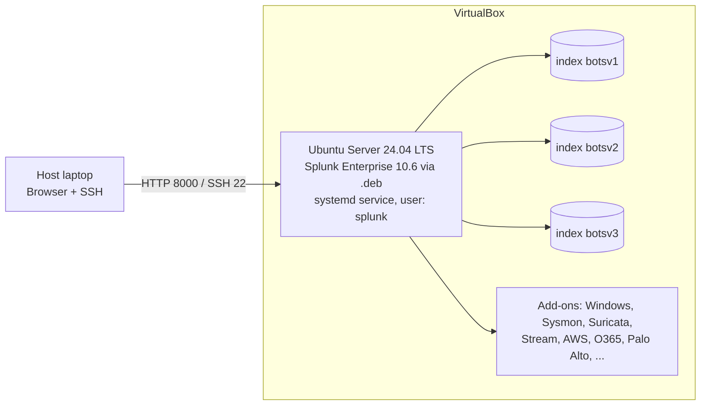

# Home SOC Lab: Splunk Enterprise + Boss of the SOC (BOTS v1, v2, v3)

A hands-on blue-team lab. I built a Splunk SIEM from scratch on Ubuntu Server, loaded three Boss of the SOC datasets, and use them to practice threat hunting, log analysis, and incident investigation.

> **Status:** Lab built. Investigation write-ups are added to [`investigations/`](investigations/) as I work through the scenarios.
> **Environment:** Isolated home lab. No production systems or real organizational data.

## Table of Contents

1. [Project Goals](#project-goals)
2. [Lab Architecture](#lab-architecture)
3. [Specifications](#specifications)
4. [Datasets](#datasets)
5. [Repository Structure](#repository-structure)
6. [Setup Summary](#setup-summary)
7. [Verification](#verification)
8. [Lessons Learned](#lessons-learned)
9. [Investigation Methodology](#investigation-methodology)
10. [Skills Demonstrated](#skills-demonstrated)
11. [Roadmap](#roadmap)
12. [References](#references)

## Project Goals

- Build a working SIEM without a pre-built image, so I understand every layer.
- Learn Splunk fundamentals: indexes, sourcetypes, SPL, time ranges, field extraction, add-ons.
- Practice SOC analyst workflows: triage, pivoting between data sources, building attack timelines.
- Document the whole process, including mistakes, the way an engineer writes a runbook.

## Lab Architecture



- Single-instance deployment: search head, indexer, and web UI on one VM.
- The datasets are pre-indexed, so no forwarders are required.
- Splunk Web on port `8000`. Management port `8089` is not exposed outside the lab network.

## Specifications

| Component | Value |
|---|---|
| Hypervisor | Oracle VirtualBox |
| Guest OS | Ubuntu Server 24.04 LTS |
| vCPU | 4 |
| RAM | 8 GB |
| Disk | 100 GB |
| Network | Bridged adapter |
| SIEM | Splunk Enterprise 10.6 (`.deb`) |

## Datasets

| Version | Index | Compressed size | Built on |
|---|---|---|---|
| BOTS v1 | `botsv1` | about 6.1 GB (full) | Splunk 6.5.2 |
| BOTS v2 | `botsv2` | 16.4 GB (full) | Splunk 7.2.1 |
| BOTS v3 | `botsv3` | about 320 MB | Splunk 7.1.7 |

Datasets are published by Splunk. This repository does not redistribute them. See the official repositories: [`splunk/botsv1`](https://github.com/splunk/botsv1), [`splunk/botsv2`](https://github.com/splunk/botsv2), [`splunk/botsv3`](https://github.com/splunk/botsv3).

## Repository Structure

```text
.
├── README.md                     # this file
├── docs/
│   ├── 01-splunk-installation.md # Ubuntu + Splunk .deb + systemd
│   ├── 02-bots-datasets-setup.md # BOTS v1, v2, v3 + add-ons
│   ├── 03-troubleshooting.md     # real issues and fixes
│   └── 04-command-cheatsheet.md  # service, logs, tmux, SPL starters
├── investigations/               # my own write-ups per scenario
│   ├── README.md                 # index table + rules
│   └── _TEMPLATE.md              # write-up template
└── screenshots/                  # evidence and setup screenshots
```

## Setup Summary

Full commands are in [`docs/`](docs/). High-level flow:

1. Create the VM (4 vCPU, 8 GB RAM, 100 GB disk) and install Ubuntu Server 24.04 with OpenSSH.
2. Download the Splunk Enterprise `.deb` and install it with `dpkg`.
3. Create the admin account with `user-seed.conf`, then do the first start as the `splunk` user.
4. Replace the default init.d boot script with a systemd-managed service running as `splunk`.
5. Log in to Splunk Web on port 8000.
6. Download each BOTS dataset with `wget -c` inside `tmux`, verify integrity, and extract into `/opt/splunk/etc/apps/` as the `splunk` user.
7. Restart Splunk and verify each index.
8. Install the add-ons listed in each dataset's README (compatible with Splunk 10).
9. Take a VM snapshot of the known-good state.

Details: [01 Installation](docs/01-splunk-installation.md), [02 Datasets](docs/02-bots-datasets-setup.md).

## Verification

Run in Search & Reporting with the Time Range set to **All time**:

```spl
| tstats count where index=botsv1 OR index=botsv2 OR index=botsv3 by index
```

<!-- TODO: paste real results and add screenshots -->

| Check | Result |
|---|---|
| Splunk runs as the `splunk` user under systemd | ☐ |
| `index=botsv1` returns events | ☐ |
| `index=botsv2` returns events | ☐ |
| `index=botsv3` returns events | ☐ |

`[Screenshot: event count per index]`

## Lessons Learned

Summary of problems I hit and solved (full table in [docs/03-troubleshooting.md](docs/03-troubleshooting.md)):

- The `.deb` registers an init.d service, which blocks systemd mode until it is disabled.
- Starting Splunk with `sudo` ran it as root. I corrected ownership and moved it to a dedicated service account.
- Multi-gigabyte downloads need `tmux`, resumable `wget -c`, and an integrity check before extraction.
- The datasets were built on older Splunk versions than the one in this lab, so I verify each index after loading.
- Take snapshots at known-good states.

## Investigation Methodology

1. Read the question and identify the likely data source (endpoint, network, cloud, email).
2. Survey the data with `stats count by sourcetype` and inspect fields.
3. Narrow the time window and filter on known indicators (host, user, IP, hash).
4. Pivot across sources, for example from a network IP to the user and host in endpoint logs.
5. Validate with a second source before concluding.
6. Write it up in [`investigations/`](investigations/) using the template: queries, evidence, reasoning, ATT&CK mapping.

Write-ups are my own method and reasoning. Official answers are not copied.

## Skills Demonstrated

- SIEM administration: Splunk Enterprise on Linux (`.deb`, systemd, service accounts, permissions)
- Linux administration: Ubuntu Server, LVM, packages, SSH, service troubleshooting
- Virtualization: VirtualBox networking, resource sizing, snapshots
- Log analysis and SPL: searching, filtering, aggregating, correlating across sourcetypes
- Threat hunting and incident investigation: timelines and cross-source pivoting
- Frameworks: MITRE ATT&CK mapping (as write-ups are added)
- Technical documentation: reproducible runbooks and root-cause notes

## Roadmap

- [ ] Complete BOTS v1, v2, v3 scenarios with write-ups and ATT&CK mapping
- [ ] Build dashboards and saved searches
- [ ] Write detection rules and alerts based on findings
- [ ] Add a Universal Forwarder and ingest live Windows + Sysmon logs from a second VM
- [ ] Automate the setup with a shell script or Ansible

## References

- [Splunk BOTS v1](https://github.com/splunk/botsv1), [v2](https://github.com/splunk/botsv2), [v3](https://github.com/splunk/botsv3)
- [Boss of the SOC](https://bots.splunk.com)
- [Splunk Enterprise documentation](https://docs.splunk.com)
- [Splunkbase](https://splunkbase.splunk.com)
- [MITRE ATT&CK](https://attack.mitre.org)

## Disclaimer

Educational and portfolio use in an isolated lab. BOTS datasets are provided by Splunk under their respective terms and are not included in this repository. The datasets may contain offensive language, as noted in the official READMEs.
